# MP3库 · 音乐下载站

搜歌即下 MP3，歌单一键打包。基于 [musicdl](https://github.com/ofoz/musicdl) 音源层重构，
去掉了原项目的在线播放器与多端同步，只保留下载链路。

聚合网易云 / QQ 音乐 / 酷狗三个平台，按「服务端带宽最省」自动选择交付通道：
能直连的走浏览器直连（服务器每首只发约 3 KB 标签），拿不到直连的才落回服务端转码。

- 后端：Flask + SQLite（WAL），单进程多线程
- 前端：原生 JS + 纯 CSS，无框架、无 CDN、无构建步骤
- 部署：`python run.py` 或 Docker，单容器即可

| 首页 | 搜索结果 | 管理后台 |
|---|---|---|
| 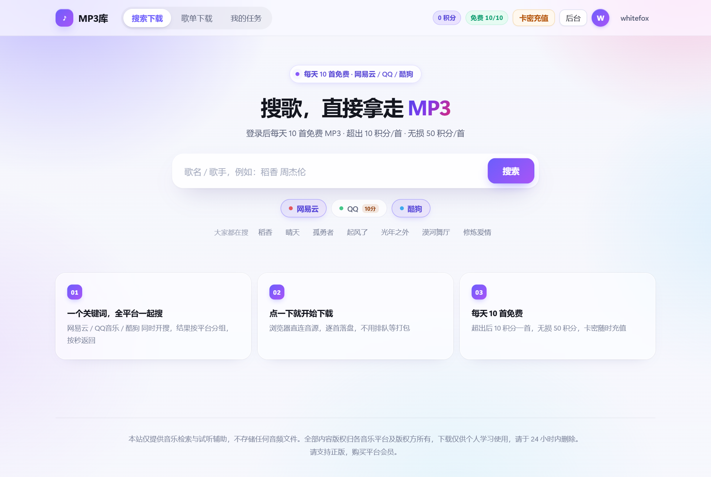 | 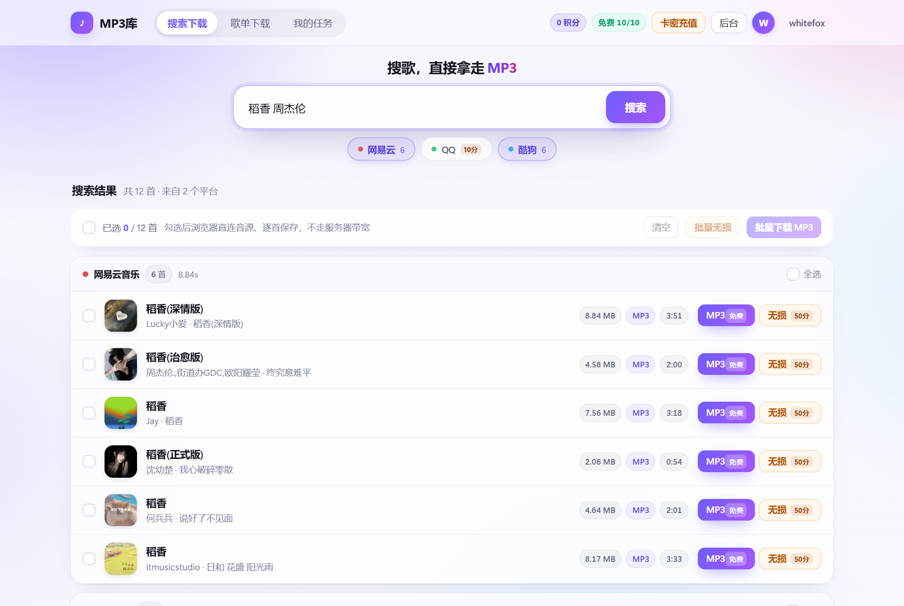 | 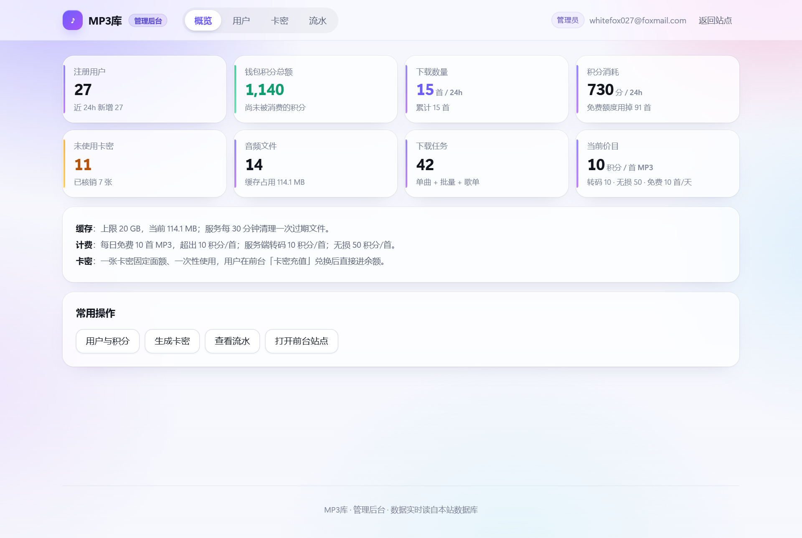 |

<details>
<summary>移动端与其它页面</summary>

| 移动端首页 | 移动端搜索 | 移动端后台 | 歌单任务 |
|---|---|---|---|
| 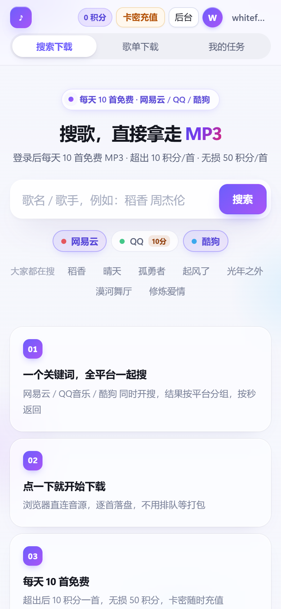 | 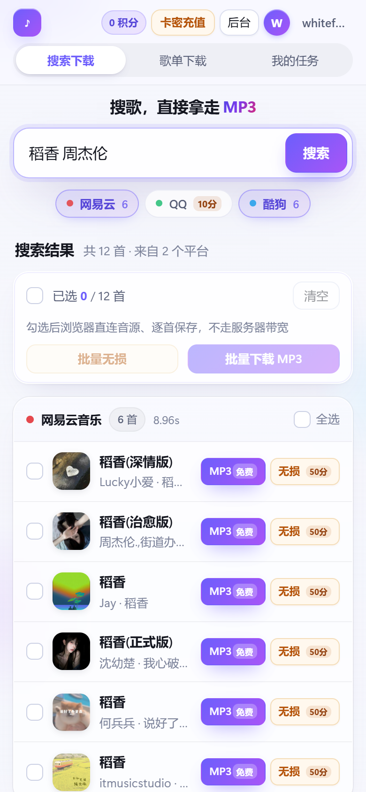 | 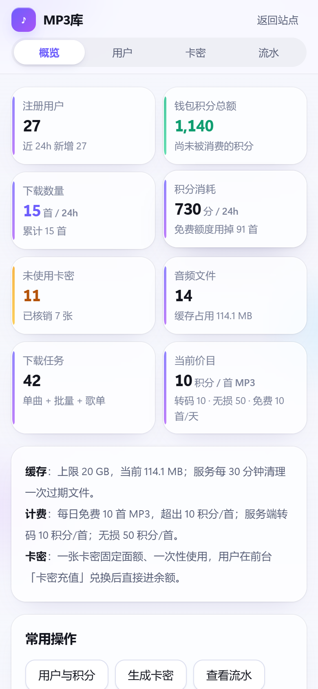 | 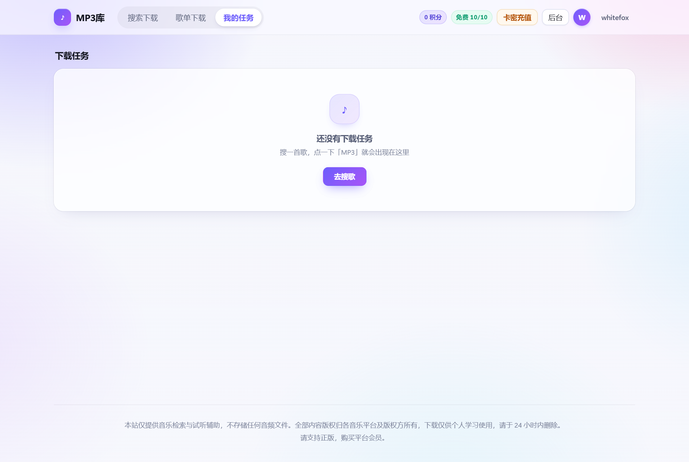 |

| 登录 | 注册 | 卡密充值 | 批量下载 |
|---|---|---|---|
| 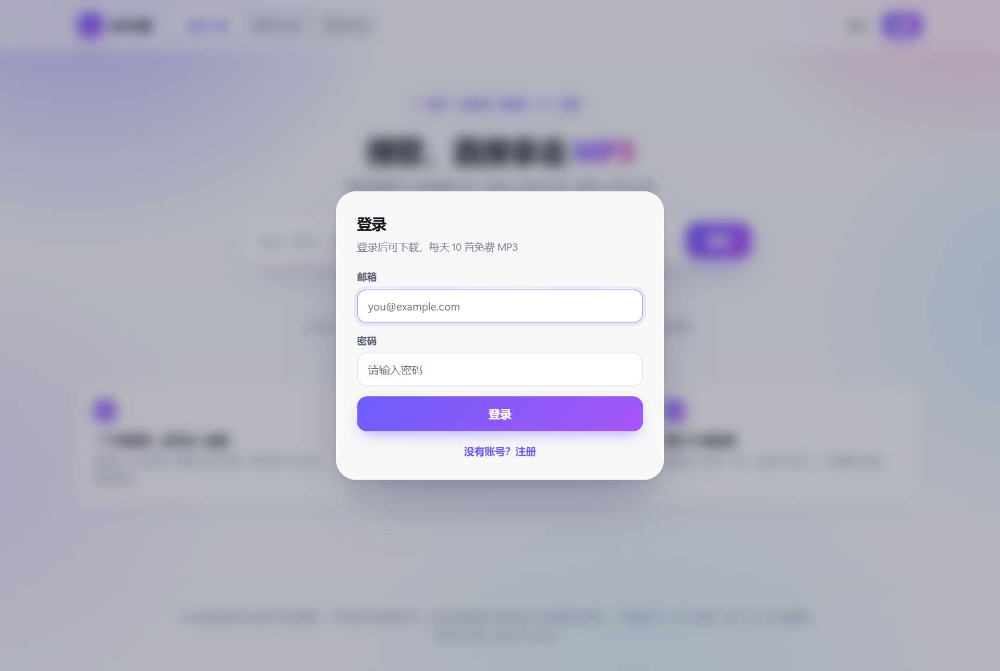 | 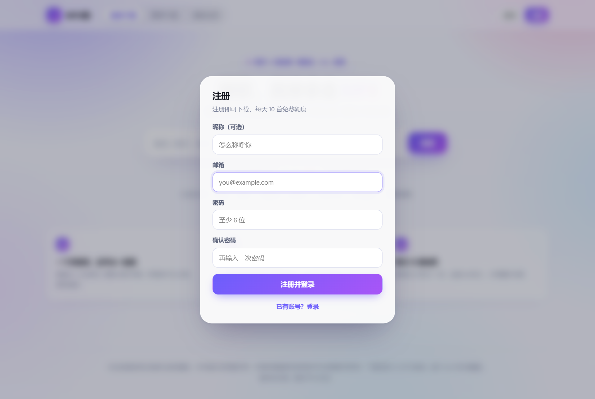 | 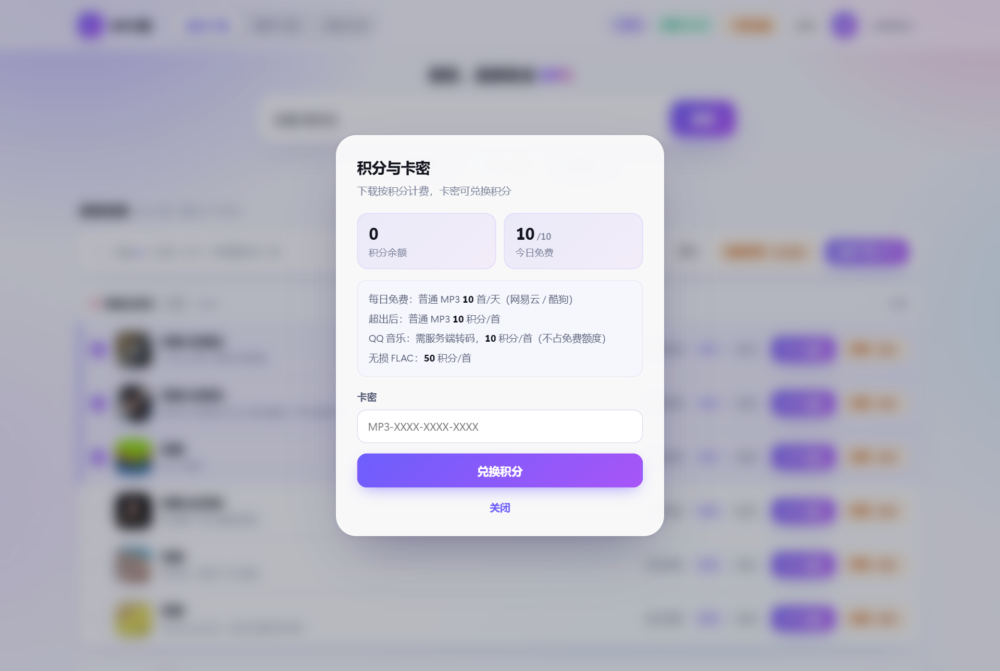 | 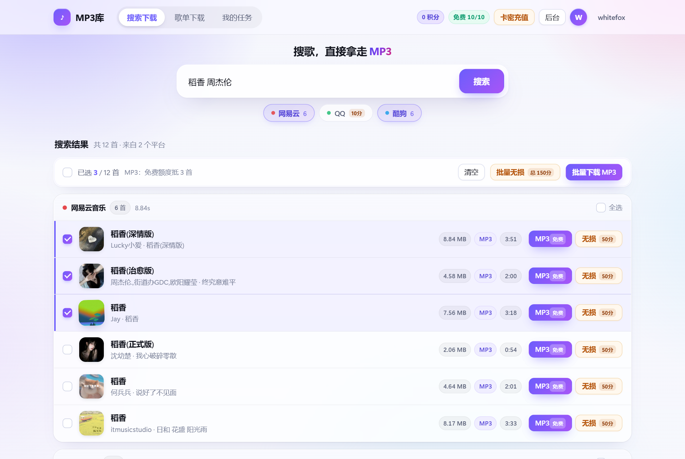 |

</details>

---

## 平台支持

| 平台 | 状态 | 默认勾选 | 说明 |
|---|---|---|---|
| 网易云 | ✅ | ✅ | `*.music.126.net`，https + `Access-Control-Allow-Origin`，可直连 |
| 酷狗 | ✅ | ✅ | 直链是 http，https 化后同样可直连 |
| QQ 音乐 | ⚠️ 可用但慢 | ⬜ | 走第三方 vkeys，单次搜索 45~110s，且只返回 ogg/flac，必须服务端转码 |
| ~~酷我~~ ~~咪咕~~ | 已下线 | — | CDN 不给 CORS，音频只能过服务器中转 |
| ~~波点~~ | 已下线 | — | 直链全部落在 `*.kuwo.cn`（酷我马甲站），同样无 CORS |
| ~~汽水~~ | 已下线 | — | 只返回 m4a，交付 mp3 必须转码，且搜到的多为翻唱 |
| ~~千千~~ | 已下线 | — | 已无可返回的音源 |

判断标准只有一条：**能不能让浏览器直连交付 mp3**。不满足就下线——因为让每首歌都过服务器带宽，
成本会直接把站点拖死。

下线平台的条目仍保留在 `PLATFORMS` 里（`enabled: False`），目的是：

1. 用户粘贴酷我/咪咕歌单链接时，给出「XX 音源不支持直连下载，已下线」的明确提示，
   而不是笼统的「不支持该链接」；
2. 万一有历史 `track_key` 残留，下载接口返回 `platform_offline`，而不是去请求已废弃的接口。

重新启用的条件很明确：该平台能提供 mp3 直链且 CDN 返回 `Access-Control-Allow-Origin`，
把条目上的 `enabled` 改回 `True` 即可。

---

## 两种「批量」的区别

| 入口 | 产出 | 音频走谁 | 打包 |
|---|---|---|---|
| 搜索结果勾选 | N 个独立文件，**在浏览器里逐首直接保存** | 用户带宽（服务端只发 302 + 标签） | 不打包 |
| 歌单解析后批量 | 一个 ZIP | 服务端（打包必须落盘） | 可选 ZIP |

搜索结果批量的三步：

1. `POST /api/download/batch/direct` 做「通道预取」：服务端只解析曲目、判定每首能否直连、
   签发直链令牌 + 标签（歌名/歌手/封面/歌词），逐首扣费；
2. 前端拿到清单后**串行**取流（一次一首，避免 N 个 8MB 文件把浏览器干崩），
   在用户机器上写 ID3 再落盘。服务端每首只发约 3 KB；
3. 拿不到直连的（QQ 这类只给 ogg/flac 的、CDN 无 CORS 的）或直连失败的，
   统一交给 `POST /api/download/batch` 建服务端任务兜底；已扣的那笔用 `reuse_charge_ids`
   挂到任务上，**不会重复扣费**。

批量提交前会先按整单算账：免费额度抵几首、还要多少积分，不够直接 402 并给出差额，
不会出现「下到一半没积分」；提交后每首单独扣费（`ref=job_id:idx`），哪首失败退哪首。

---

## 下载链路

| 档位 | 通道 | 服务端流量 | 计费 |
|---|---|---|---|
| MP3（源就是 mp3 + CDN 允许跨域） | **浏览器直连 + 本地写 ID3** | 约 3.5 KB / 首 | 先吃每日免费额度，超出 10 积分/首 |
| 搜索结果批量 MP3 | **前端串行直连**（一次一首） | 约 3 KB / 首 | 同上，逐首扣 |
| MP3（需转码 / 平台无 CORS） | 服务端中转（下载、转码、打标） | 约 9 MB / 首 | 10 积分/首 |
| FLAC（无损，含批量） | **302 直连** | 约 0.7 KB / 首 | 50 积分/首 |
| 歌单批量 ZIP | 服务端打包 | 约 9 MB / 首 | 逐首计费，失败退回 |

### 通道一：浏览器直连 + 本地打标（MP3 首选）

服务端只返回歌名/歌手/专辑/封面地址/歌词（约 2.8 KB），页面用 `fetch` 从音源 CDN
把音频读进内存，再由 `web/assets/id3.js` 在用户机器上拼出 ID3v2.3 头
（`TIT2/TPE1/TALB/APIC/USLT`，UTF-16），最后 `Blob` 落盘。

- 音频字节**完全不经过本站**，且**不重新编码**，音质与源文件一致；
- 文件名由前端 `download` 属性给出，不会变成 CDN 的哈希名；
- 封面优先直连 CDN，拿不到才退回 `/api/cover/<token>` 代理（几十 KB）。

成立条件：站点与直链同协议（https 站点遇 http 直链会先尝试升级为 https），
且 CDN 返回 `Access-Control-Allow-Origin`。探测按 CDN 域名缓存 6 小时，
只取 1 字节（`Range: bytes=0-1023`），不浪费流量。

**任一环节失败都会自动降级**：前端捕获后带 `mode:"server"` + `reuse_charge_id` 重新请求，
走服务端流水线，用户最终一定拿到文件，而且这笔下载只扣一次。

### 通道二：服务端中转

下载 → （必要时）PyAV 转 MP3 → mutagen 写 ID3/封面/歌词 → 落盘 → 下发。
这是唯一需要服务器带宽和 CPU 的路径，所以只用于「无法直连」的曲目。

服务端抓取有 500 MB 硬上限（`pipeline.MAX_TRACK_BYTES`），防止异常音源把磁盘写满。

### 通道三：无损 302 直连

`HMAC-SHA256` 签名的令牌，15 分钟过期，`/api/dl/<token>` 返回 302 跳转到 CDN。
为了绕过平台防盗链，跳转响应带 `Referrer-Policy: no-referrer`。

关闭直连（全部走服务端）：`MP3DL_MP3_BROWSER=0`。

---

## 计费：登录 + 每日免费额度 + 积分

**所有下载都必须登录**。登录后每天有免费额度，额度用完按积分计费，积分靠卡密兑换——
既防住脚本批量刷下载，也避免「全免费」被当免费带宽用。没有 VIP。

| 场景 | 价格 | 是否占每日免费额度 |
|---|---|---|
| 普通 MP3（网易云 / 酷狗，浏览器直连） | 额度内 0，超出 **10 积分/首** | 占用 |
| QQ 音乐（必须服务端转码） | **10 积分/首** | 不占 |
| 无损 FLAC（302 直连 CDN） | **50 积分/首** | 不占 |
| 歌单批量 ZIP | 逐首按上表累加，失败的曲目自动退回 | — |

- 免费额度按**账号 + 自然日（东八区）**计，默认 `MP3DL_FREE_DAILY=10`，次日 0 点重置；
- 计费在 `services/pricing.py`：`charge()` 扣权益、`refund()` / `refund_ref()` 退回。
  免费额度用 `free_quota` 表的原子自增守住上限，积分用 `UPDATE ... WHERE credits>=?`
  保证不扣成负数；
- 扣费时机：直连/无损在**确认能给出通道后**才扣；任务型下载先扣、曲目失败自动退回；
- 浏览器直连失败降级到服务端时，前端带 `reuse_charge_id` 回来，**复用同一笔扣费**；
- 积分流水落在 `credit_ledger`，用户可在「积分与卡密」弹窗看最近 5 条，
  管理员可查 `/api/admin/ledger`。

防刷叠了四道：下载必须登录、同 IP 每日注册上限（默认 3）、IP 维度下载限频、
IP 维度日曲目总量上限。内网自用可整体关掉计费：`MP3DL_BILLING=0`。

---

## 快速开始

### 前置：musicdl 源码

musicdl **不通过 pip 安装**，是以源码方式 import 的（`app/services/musicdl_env.py` 负责注入
`sys.path`）。目录必须是同级：

```
workspace/
├── musicdl-src/     <- musicdl 源码
└── mp3dl/           <- 本项目
```

### 本地运行

```bash
cd mp3dl

# 1. 依赖（建议放同级 venv，别污染系统环境）
python -m venv ../.venv
../.venv/Scripts/pip install -r requirements.txt     # Windows
# ../.venv/bin/pip install -r requirements.txt       # Linux / macOS

# 2. 配置
cp .env.example .env        # 至少改 MP3DL_SECRET 和两个管理员项
# 让当前 shell 读到 .env
set -a && source .env && set +a                      # bash
# Windows PowerShell: 自己 $env:MP3DL_XXX="..."，或直接写系统环境变量

# 3. 启动
../.venv/Scripts/python run.py      # Windows  → http://127.0.0.1:9080
# ../.venv/bin/python run.py        # Linux / macOS
```

管理员账号由 `MP3DL_ADMIN_EMAIL` / `MP3DL_ADMIN_PASSWORD` 在**首次启动时**创建。
之后改这两个环境变量**不会**修改已有账号的密码——要改密码走接口，别指望改 env 生效。

首次启动还会做两件事：自动建表 / 迁移（`db._migrate()`），
以及检测 `MP3DL_SECRET` 仍是示例值时生成随机密钥并持久化到 `storage/.secret_key`（权限 600）。

### Docker

```bash
cd mp3dl
cp .env.example .env        # 至少改 MP3DL_SECRET 和管理员两项
docker compose up -d --build
```

构建上下文就是 **mp3dl 目录本身**：音源解析库已收进 `vendor/musicdl`，
`git clone` 下来即可构建，不依赖工作区里的兄弟目录。

生产部署（1Panel + OpenResty + HTTPS + 域名）的完整步骤见
**[deploy/DEPLOY.md](deploy/DEPLOY.md)**，反向代理模板见
[deploy/openresty-mp3.dbas.fun.conf](deploy/openresty-mp3.dbas.fun.conf)。

> **容器里用 `gunicorn -w 1`，不要加 worker。** 曲目直链缓存、任务队列、转码线程池
> 全都在进程内，多 worker 会各自为政：缓存命中不了、任务进度互相看不见。
> 需要横向扩展时，先把 `services/jobs.py` 的任务消费挪到独立进程。

容器只监听 `127.0.0.1:9080`，由宿主上的 OpenResty 终止 TLS 并反代。

---

## 目录结构

```
mp3dl/
├── app/
│   ├── config.py            环境变量配置（所有可调项集中在这里）
│   ├── db.py                SQLite 建表 / 迁移 / DAO
│   ├── security.py          口令哈希 / 会话 / 客户端 IP / 钱包快照
│   ├── ratelimit.py         IP 维度滑动窗口限流
│   ├── api/                 auth / catalog / download / playlists / jobs / admin
│   └── services/
│       ├── pricing.py       计费：定价 / 免费额度 / 积分扣减与退回 / 卡密
│       ├── quality.py       音质档位（MP3 320k / 无损）上下文切换
│       ├── platforms.py     平台注册表 + 并发搜索 + 曲目缓存
│       ├── pipeline.py      下载 -> 转码 -> 打标 -> 入库
│       ├── transcode.py     PyAV 转 MP3
│       ├── tagger.py        mutagen 写 ID3/封面/歌词 + 封面抓取白名单
│       ├── direct.py        直连令牌（HMAC 签名 + 15 分钟有效期）
│       ├── playlists.py     歌单链接解析（异步任务）
│       ├── jobs.py          任务队列 + 进度 + ZIP 打包
│       └── musicdl_env.py   把 vendor/musicdl 注入 sys.path
├── web/                     前端（原生 JS + 纯 CSS，无 CDN、无构建）
│   ├── index.html           站点首页
│   ├── admin.html           管理后台（/admin）
│   └── assets/              app.js / id3.js / admin.js / style.css / admin.css
├── vendor/musicdl/          音源解析库源码（以 import 方式引入，不 pip 安装）
├── deploy/                  DEPLOY.md 部署手册 + OpenResty 反代配置模板
├── tests/                   回归测试（Flask test_client，不依赖外网）
├── tools/clean_test_data.py 清库脚本（保留管理员）
├── ui/                      README 用的界面截图
├── storage/                 SQLite / 音频缓存 / 临时文件（可用卷挂载出来）
├── Dockerfile               构建上下文 = 本目录
├── docker-compose.yml       单容器编排（只绑 127.0.0.1:9080）
└── run.py
```

---

## 主要接口

| 方法 | 路径 | 说明 |
|---|---|---|
| GET | `/api/platforms` | 平台清单 |
| GET | `/api/search/stream?q=&platforms=` | SSE 流式搜索，逐平台返回 |
| GET | `/api/search?q=&platforms=` | 搜索（一次性返回全部平台结果，前端优先用流式版） |
| POST | `/api/download` | `{track_key, quality, mode?, reuse_charge_id?}` → `{mode:"browser"\|"job"\|"direct", charge_id, wallet, ...}` |
| POST | `/api/download/batch/direct` | `{track_keys[], quality}` → `{ready:[{mode,url,filename,tags,charge_id}], need_server:[...], skipped, wallet}` |
| POST | `/api/download/batch` | `{track_keys[], quality, reuse_charge_ids?}` → `{job_id, total, plan, skipped, wallet}`，整单算账，不足 402 |
| GET | `/api/jobs` | 我的任务（含曲目与 `file_id`，供逐首下载） |
| GET | `/api/jobs/<id>` | 任务进度 |
| GET | `/api/jobs/<id>/zip` | 打包下载 |
| GET | `/api/files/<token>` | 单曲下发（需登录） |
| GET | `/api/dl/<token>` | 直连 302（需登录） |
| GET | `/api/cover/<token>` | 封面代理（直连不可用时的兜底，需登录） |
| POST | `/api/playlist/parse` | `{url}` → `{task_id}` |
| GET | `/api/playlist/parse/<task_id>` | 解析进度 + 曲目 |
| POST | `/api/playlist/download` | `{track_keys, quality}` → `{job_id, plan, wallet}` |
| POST | `/api/auth/register` `/login` `/logout` | 账号 |
| GET | `/api/auth/me` | 当前用户 + 钱包（积分 / 今日免费余量 / 价目） |
| GET | `/api/auth/wallet` | 钱包 + 积分流水 |
| POST | `/api/auth/redeem` | `{code}` 卡密兑换积分 |
| GET | `/api/health` | 各平台探活（缓存 5 分钟） |

错误码约定：`401 login_required`（未登录）、`402 credits_insufficient`（积分不足，带
`need/balance/short`）、`429 rate_limited`（限频 / 日上限）。

---

## 管理后台

管理员登录后顶栏出现「后台」按钮，或直接访问 `/admin`。页面本身是公开的静态壳，
数据全部走 `/api/admin/*`（接口层鉴权），非管理员看到「权限不足」。

| 页签 | 内容 |
|---|---|
| 概览 | 用户数 / 24h 新增、钱包积分总额、24h 下载与积分消耗、未用卡密、文件与缓存占用、当前价目 |
| 用户 | 搜索邮箱或昵称、分页加载、调积分（±，带快捷面额）、设为 / 取消管理员、禁用 / 启用 |
| 卡密 | 按面额 + 数量生成（一次最多 100 张）、复制全部、下载 TXT、卡密记录（含使用者与备注） |
| 流水 | 最近 100 / 200 / 500 条积分变动，含类型、变动值、余额、备注 |

安全约束：不能取消自己的管理员权限，也不能把站点最后一个管理员降级或禁用。

不用网页也能操作：

```bash
# 登录拿 cookie
curl -c ck.txt -X POST localhost:9080/api/auth/login \
  -H 'Content-Type: application/json' \
  -d '{"email":"admin@example.com","password":"..."}'

# 生成 10 张 100 积分的卡密
curl -b ck.txt -X POST localhost:9080/api/admin/codes \
  -H 'Content-Type: application/json' -d '{"credits":100,"count":10}'

# 直接给用户发 200 积分（负数表示扣减）
curl -b ck.txt -X POST localhost:9080/api/admin/credits \
  -H 'Content-Type: application/json' -d '{"email":"user@example.com","credits":200}'

# 看积分流水 / 站点数据
curl -b ck.txt localhost:9080/api/admin/ledger
curl -b ck.txt localhost:9080/api/admin/stats
```

---

## 安全设计

站点对外暴露的是「登录、搜索、下载、管理」四个面，每一条都做了明确约束。
下面这些不是理论项——都是照着攻击路径逐条压过的。

### 身份与会话

- 口令用 PBKDF2-SHA256（120k 迭代）存储，校验走 `hmac.compare_digest`（防时序侧信道）；
- 会话是**服务端会话表**，不是签名 Cookie。注销即刻失效，不用等过期；
- Cookie `HttpOnly + SameSite=Lax`，HTTPS 下自动加 `Secure`。

### 客户端 IP 与限流

限流的正确性完全取决于「拿到的 IP 是不是真的」。所以 `X-Forwarded-For` 只在
**请求确实来自可信代理**时才采信（`MP3DL_TRUSTED_PROXIES` 白名单，支持 CIDR），
并且从**右往左**取第一个非代理地址——最左边那个是客户端自己可以随便写的。

直连公网时 `remote_addr` 就是真实 IP，伪造 XFF 头完全无效。

### 文件与路径

- 缓存文件的 URL 用**随机 token**（`secrets.token_hex(16)`），不用内容哈希。
  哈希可以从公开的曲目信息（平台/曲目 id/歌名/音质）算出来，等于把整站缓存免费开放；
- 单曲下发、ZIP、任务详情都先校验 `user_id` 归属，越权直接 404；
- 文件名过滤 `<>:"/\|?*` 与换行，ZIP 的 `arcname` 由此生成，不存在 Slip 路径；
- ZIP 落在 `storage/tmp/zip/{job_id}.zip`（站点内、同名覆盖），不用系统 `/tmp`，
  且有定时兜底清理。

### 服务端抓取（SSRF）

`/api/cover` 本质是「服务器替你抓一个 URL」，不加限制就是现成的 SSRF，能打内网服务和云元数据。
三道约束缺一不可：

1. 必须登录；
2. 目标域名必须在白名单内（内置网易云/QQ/酷狗/酷我/migu 等 CDN，可用 `MP3DL_COVER_HOSTS` 追加）；
3. 解析后的 IP 拒绝回环 / 私网 / 链路本地 / 保留 / 组播地址，且**禁止跟随重定向**。

`services/direct.py` 的 CORS 探测同样只对公网地址发起。

### 计费与状态机

- 扣费、退款都是**原子条件更新**，不是「先查再改」：
  退款走 `UPDATE charges SET status='refunded' WHERE id=? AND status!='refunded'`，
  靠 `rowcount` 判断这笔到底是不是我退的，并发重试只会成功一次；
- 已挂到任务上的那笔扣费不会被别的请求复用（防「一次付费跑多个任务」）；
- 任务计数用库内自增，不用「读出来 +1 再写回」，避免并发丢计数把任务卡在「进行中」。

### 管理面

- `/api/admin/*` 全部过 `admin_required`；
- 不能禁用自己、不能禁掉最后一个可登录的管理员（否则站点直接锁死）；
- 卡密用 `secrets.choice` 生成。`random` 是 MT19937，观测到足够输出就能反推内部状态。

### 部署时务必确认

| 事项 | 说明 |
|---|---|
| `MP3DL_SECRET` | 单实例留空会自动生成并持久化到 `storage/.secret_key`；**多实例必须显式设为同一个值**，否则各实例签的直链互不认 |
| `MP3DL_TRUSTED_PROXIES` | 必须与实际反代来源一致。反代在外网独立机器时，把它的出口 IP 加进去，否则所有用户会被识别成同一个 IP，限流变成「全体共享一个配额」 |
| 反向代理 | 只监听 `127.0.0.1:9080`，由 Nginx/OpenResty 终止 TLS 并转发；`MP3DL_SITE_HTTPS=1` 让程序知道对外是 https |

---

## 配置项

全部集中在 `app/config.py`，都可用环境变量覆盖。`*` 为上线前必须确认的项。

### 站点

| 变量 | 默认 | 说明 |
|---|---|---|
| `MP3DL_SITE_NAME` | MP3库 | 站点名（页头 / 标题） |
| `MP3DL_SLOGAN` | 搜歌即得 MP3，歌单一键打包 | 副标题 |
| `MP3DL_HOST` / `MP3DL_PORT` | 127.0.0.1 / 9080 | 监听地址 |
| `MP3DL_SECRET` * | 开发默认值 | 会话 + 直连令牌签名。示例值会自动替换为随机密钥并落盘 |
| `MP3DL_DEBUG` | 0 | 调试模式（会开 Werkzeug 调试器，**生产必须 0**） |
| `MP3DL_SITE_HTTPS` | 0 | 站点对外是 https 时设 1 |
| `MP3DL_TRUSTED_PROXIES` * | `127.0.0.1,::1,10.0.0.0/8,172.16.0.0/12,192.168.0.0/16` | 可信反代网段，只有它们的 XFF 会被采信 |
| `MP3DL_ADMIN_EMAIL` / `MP3DL_ADMIN_PASSWORD` | 空 | 首次启动创建管理员，之后改无效 |
| `MP3DL_COVER_HOSTS` | 空 | 追加允许代理抓取的封面域名后缀（逗号分隔） |

### 搜索与下载

| 变量 | 默认 | 说明 |
|---|---|---|
| `MP3DL_SEARCH_SIZE` | 6 | 每个平台返回多少条 |
| `MP3DL_SOURCE_TIMEOUT` | 45 | 单平台搜索超时兜底（QQ 单独配了 150，见平台元数据 `timeout`） |
| `MP3DL_JOB_WORKERS` | 3 | 并发下载/转码数，1C2G 建议 2~3 |
| `MP3DL_MAX_TRANSCODE` | 3 | 同时转码上限 |
| `MP3DL_MAX_PLAYLIST` | 200 | 单次歌单上限 |
| `MP3DL_MAX_BATCH` | 100 | 搜索结果批量单次上限 |
| `MP3DL_MP3_BITRATE` | 320 | 转码目标码率 |
| `MP3DL_MP3_BROWSER` | 1 | MP3 优先浏览器直连（0 = 全部走服务端中转） |

### 计费

| 变量 | 默认 | 说明 |
|---|---|---|
| `MP3DL_BILLING` | 1 | 计费总开关（0 = 全部免费且不扣额度，仅内网自用） |
| `MP3DL_FREE_DAILY` | 10 | 每账号每日免费 MP3 首数 |
| `MP3DL_PRICE_MP3` | 10 | 超出免费额度后普通 MP3 的积分价 |
| `MP3DL_PRICE_TRANSCODE` | 10 | 需服务端转码平台（QQ）的积分价 |
| `MP3DL_PRICE_FLAC` | 50 | 无损 FLAC 的积分价 |
| `MP3DL_CARD_PREFIX` / `MP3DL_CARD_CREDITS` | MP3 / 100 | 卡密前缀 / 默认面额 |
| `MP3DL_TZ_OFFSET` | 8 | 「每天」按哪个时区切日（免费额度重置时间） |

### 缓存与限流

| 变量 | 默认 | 说明 |
|---|---|---|
| `MP3DL_FILE_KEEP_HOURS` | 24 | 单曲缓存保留时长，从最后一次被下载起算 |
| `MP3DL_CACHE_MAX_GB` | 20 | 缓存容量上限（超了按 LRU 删） |
| `MP3DL_RL_SEARCH` | 20 | 每 IP 每分钟搜索次数 |
| `MP3DL_RL_DOWNLOAD` | 10 | 每 IP 每分钟下载请求数 |
| `MP3DL_RL_DAILY` | 300 | 每 IP 每日曲目总量 |
| `MP3DL_RL_AUTH` | 10 | 每 IP 每分钟登录尝试 |
| `MP3DL_RL_REGISTER_DAY` | 3 | 同 IP 每日可注册账号数（防刷小号领免费额度） |

### 存储

| 变量 | 默认 | 说明 |
|---|---|---|
| `MP3DL_STORAGE` | `./storage` | 数据根目录 |
| `MP3DL_DB` | `storage/mp3dl.db` | SQLite 路径 |
| `MP3DL_MUSICDL_DIR` | `storage/musicdl` | musicdl 自身的缓存目录 |
| `MUSICDL_SRC` | `../musicdl-src` | musicdl 源码位置 |

---

## 测试

测试全部基于 Flask `test_client`，**不依赖外网**，可以直接在开发机跑：

```bash
cd mp3dl
pip install -r requirements.txt        # 首次

python tests/test_security.py          # 安全检查（缓存表有数据时 26 项，表空则跳过 4 项）
python tests/test_billing.py           # 计费 / 免费额度 / 退款幂等
python tests/test_delivery.py          # ZIP 与单曲交付
python tests/test_batch.py             # 批量提交与整单算账
python tests/test_batch_direct.py      # 批量直连预取
```

需要管理员身份的用例（生成卡密、管理员自我保护、真实冒烟）从环境变量取凭据，**代码里不存任何账号密码**：

```bash
export MP3DL_TEST_ADMIN_EMAIL=admin@mp3dl.local
export MP3DL_TEST_ADMIN_PASSWORD='你的管理员密码'

python tests/test_security.py          # 第 9 节才会真正执行
python tests/smoke_live.py             # 需要服务已在运行
```

未设置时这些用例打印 `skip` 后跳过，不计为失败。

| 文件 | 覆盖内容 |
|---|---|
| `test_security.py` | 密钥强度、封面代理鉴权与白名单、伪造令牌、缓存 token、XFF 信任链、退款幂等与并发、管理员自我保护、卡密随机源 |
| `test_billing.py` | 免费额度边界、积分扣减、余额不允许为负 |
| `test_delivery.py` | ZIP 打包内容、单曲下发、临时文件不残留 |
| `test_batch.py` / `test_batch_direct.py` | 批量直连预取 → 服务端兜底的扣费复用 |

另外两个脚本需要服务已在运行：

```bash
python tests/smoke_live.py    # 真实端口冒烟：搜索 -> 下载 -> 扣费
python tests/sec_probe.py     # 只读攻击面探测（不改数据）
```

> 测注册相关用例时注意：注册接口按 IP 每日限 3 次，测试脚本必须给每次注册分配独立
> 模拟 IP，并在开跑前清掉 `rate_events` 里对应网段的记录，否则重复执行会被上一轮数据挡住。

---

## 运维

### 备份与恢复

整个状态就在 `storage/` 一个目录里：`mp3dl.db`（+ WAL）、`cache/`、`tmp/`、`.secret_key`。

```bash
# 热备份（WAL 下也能拿到一致快照）
sqlite3 storage/mp3dl.db ".backup 'backup-$(date +%F).db'"

# 恢复
docker compose down            # 或停掉 run.py
rm -f storage/mp3dl.db-wal storage/mp3dl.db-shm
cp backup-2026-10-21.db storage/mp3dl.db
docker compose up -d
```

`.secret_key` 记得一起备份：换了它，已签发的直链和所有人的登录态都会失效
（数据不丢，只是要重新登录）。

### 清理测试数据

`tools/clean_test_data.py` 用于把站点重置成「只剩管理员」的干净状态：

```bash
python tools/clean_test_data.py             # 预览，只打印不落地
python tools/clean_test_data.py --yes       # 自动备份后执行
python tools/clean_test_data.py --yes --keep-cache   # 保留音频缓存
```

它做的事：备份数据库到 `storage/backups/` → 单事务删掉非管理员用户及其关联数据
（任务、扣费、积分流水、卡密、下载日志、免费额度、限流计数、缓存索引、旧会话）
→ 重置自增序列 → `VACUUM` → 清音频缓存与 ZIP 残留 → 复核。

保留：`is_admin=1` 的账号原样不动（含密码哈希），每个管理员留最近 5 条会话以免被踢下线。

### 缓存清理

用户下载留下的音频文件落在 `storage/cache/<sha1 前两位>/`，由后台守护线程
`_cleanup_loop()` 每 **30 分钟**调一次 `pipeline.cleanup_cache()` 回收：

| 对象 | 位置 | 保留时长 | 说明 |
|---|---|---|---|
| 单曲音频（mp3/flac） | `storage/cache/` | `MP3DL_FILE_KEEP_HOURS`（默认 **24 小时**） | 从**最后一次被下载**（`last_access`）起算，不是首次生成时间；命中缓存会刷新计时 |
| 打包 ZIP | `storage/tmp/zip/` | **1 小时** | 正常响应结束即删，这是「发到一半断线」的兜底 |
| 下载临时文件 | `storage/tmp/*.src` | **立即** | 下载/转码完成在 `finally` 里删，失败也不留 |
| musicdl 搜索缓存 | `storage/musicdl/` | **6 小时** | 库自身的 `search_results.pkl`，本站不用；启动时也会清一次 |
| 限流计数 | 数据库 `rate_events` | **7 天** | 每轮清理顺带 GC |

超出 `MP3DL_CACHE_MAX_GB`（默认 20GB）时，按 `last_access` 升序（最久未访问优先）
删到上限的 80% 为止。

因为清理是每 30 分钟一轮的轮询，实际删除时间是「**保留时长 + 最多 30 分钟**」——
即默认情况下文件在最后一次下载后 **24~24.5 小时**之间消失。

缓存超过保留期的直接后果：用户再点这首歌要重新走一次云端下载与扣费（`/api/files/<token>`
返回 404「文件已过期，请重新下载」）。想延长就调大 `MP3DL_FILE_KEEP_HOURS`；
手动清空直接删 `storage/cache/` 下内容即可，目录本身留着（写入时会自动重建）。

> 旧变量 `MP3DL_CACHE_TTL_HOURS` 在早期版本里只写进了文档、从未接入清理逻辑（改了不起作用）。
> 现在它作为回退值保留：没设 `MP3DL_FILE_KEEP_HOURS` 时才会读它。新部署请只用后者。

---

## 已知限制

1. **平台接口随时会变**：音乐平台经常改签名/风控。某个平台挂了先看 `/api/health`，
   把 `services/platforms.py` 里 `PLATFORMS` 对应条目的 `default`（不再默认选中）
   或 `enabled`（彻底下线）关掉即可，不影响其它平台。
2. **搜索耗时取决于平台**：实测网易云 9s、酷狗 27s、QQ 45~110s。前端用 SSE 逐平台返回，
   慢的平台不会拖住整页。每个平台可单独配超时（`PLATFORMS[key]["timeout"]`）。
3. **单进程限制**：曲目直链缓存在内存（30 分钟），多 worker 命中不了，见 Docker 一节。
4. **无损可用性**：取决于源站有没有无损版权，没有时前端提示「该曲目在源站没有无损版本」。
5. **批量默认零带宽**：搜索结果批量走「前端串行直连 + 本地打标」，服务端每首约 3 KB。
   代价是浏览器会连续触发多个下载，第一次会弹「允许多个下载」，点允许即可。
   仍落服务端的只有两类：**歌单 ZIP**（打包必须落盘）和**需转码的曲目**（转码只能服务器做）。
6. **批量不打包**：搜索结果批量产出 N 个独立文件（浏览器直接保存，不进任务列表）；
   歌单批量才是「一个任务 N 个文件 + 可选 ZIP」，任务列表可逐首下载，也可「下载 N 首」
   按 900ms 间隔连续触发。
7. **计费以「一条下载权益」为单位**：同一首重复下载会重复计费（免费额度或积分），
   这是刻意的——否则脚本可以反复请求同一首歌。直连失败降级服务端时复用同一笔，
   任务型下载失败的曲目自动退回。
8. **额度按账号不按 IP**：同一 WiFi 下多个账号各算各的，防的是脚本不是家人共用。

---

## 免责声明

本站仅提供音乐检索与下载辅助，**不存储任何音频文件**，所有内容版权归各音乐平台及版权方所有。
请勿用于商业用途，下载内容请于 24 小时内删除，并支持正版。购买平台会员是最稳妥的做法。

使用者需自行承担因使用本工具产生的一切法律责任。
